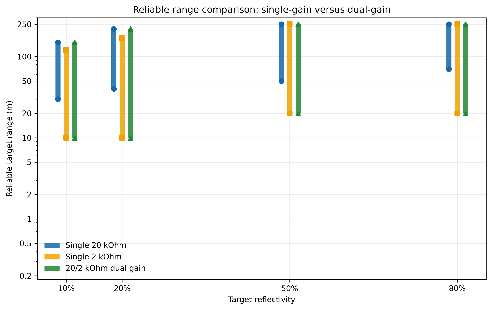
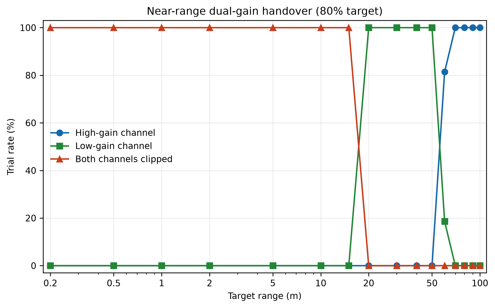
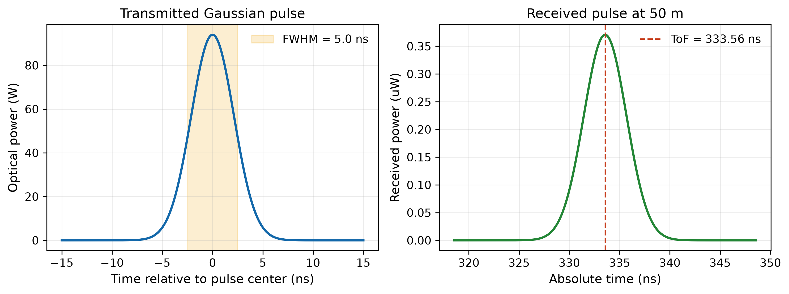
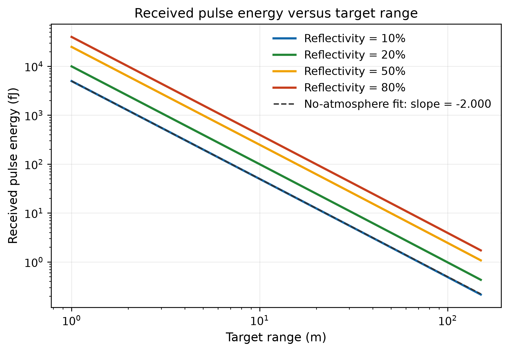
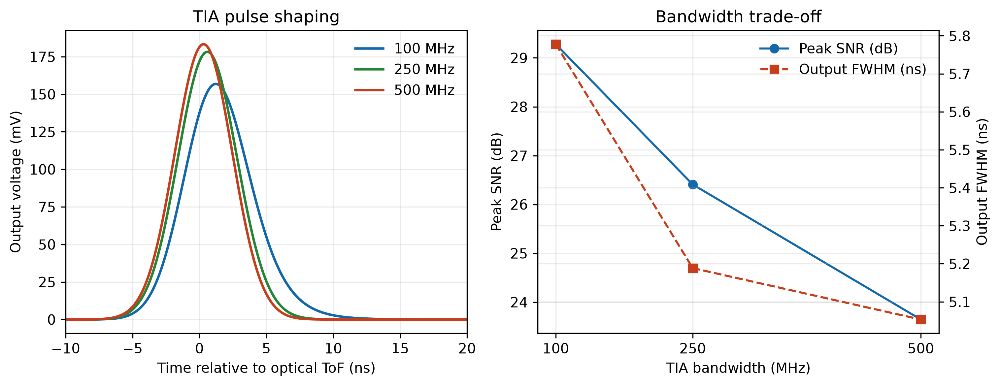
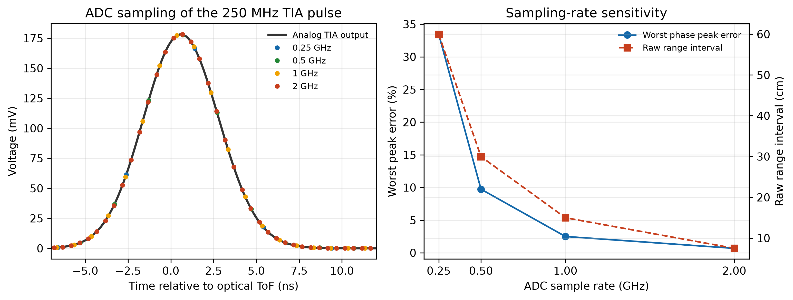
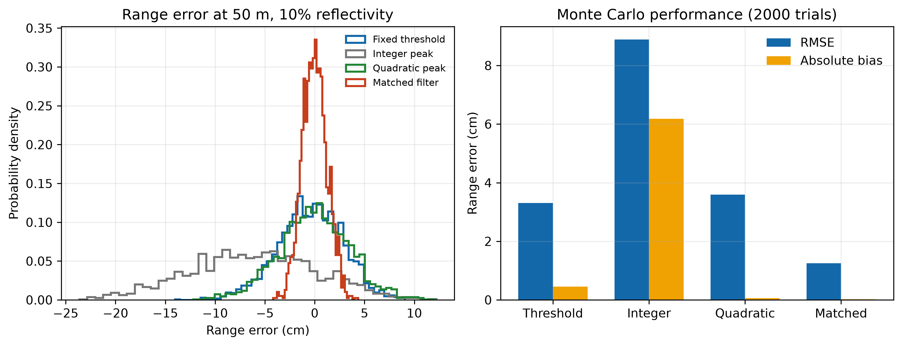
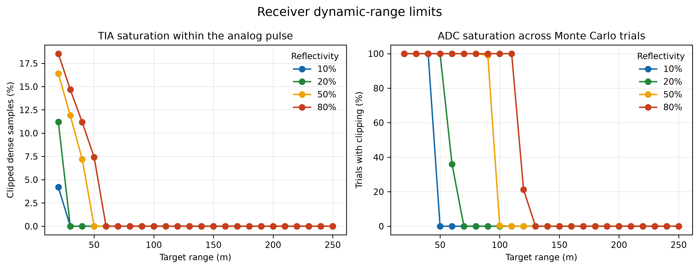
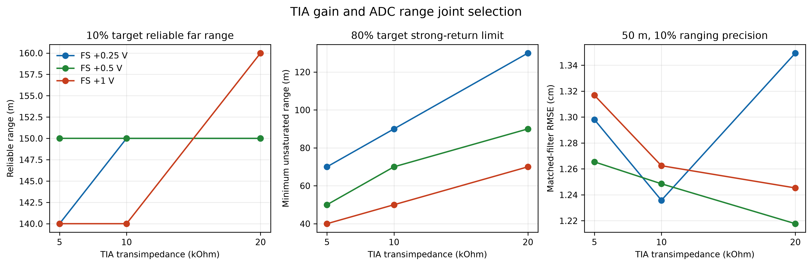
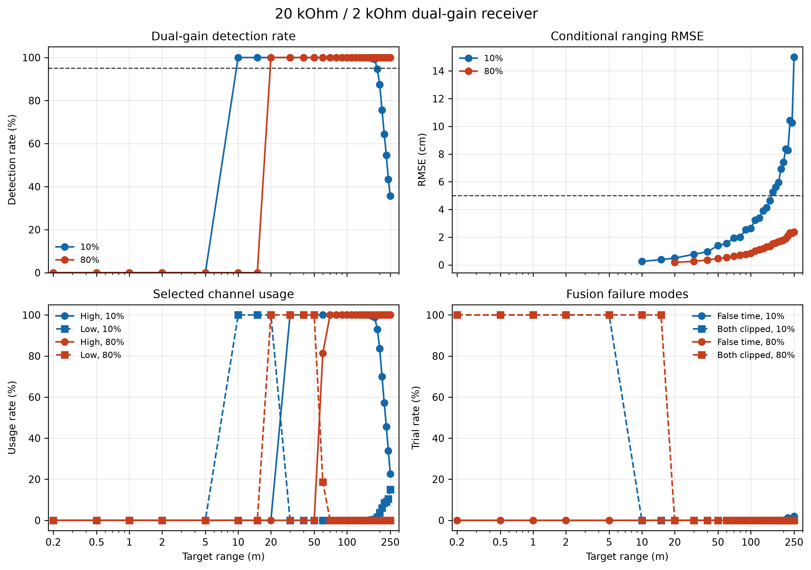

> **给成像 / CIS 方向的读者**
>
> 本项目建模的是一条光电探测链路：光子 → 光电子 → 跨阻放大 → ADC → 数字估计。
> 这与 CMOS 图像传感器的像素读出链路是同一套物理，噪声预算、动态范围与增益切换的分析可直接迁移。
> 本项目为仿真研究，未做硬件实测；参数来源与模型边界见 `docs/assumptions_and_sources.md`。

# Simulation and Dual-Gain Design of dToF LiDAR Receivers for Wide-Dynamic-Range Ranging

**面向宽动态测距的 dToF 激光雷达接收机仿真与双增益设计**

### 5 分钟导读
1. `docs/technical_report_cn.md` 第 1–2 节：问题定义与链路模型
2. `results/figures/10_dual_gain_receiver.png`：双增益效果
3. `docs/assumptions_and_sources.md`：参数来源与模型边界

A system-level simulation of a 905 nm pulsed dToF LiDAR receiver,
covering optical propagation, Si APD detection, TIA/ADC design,
bottom-level ranging algorithms, and receiver architecture comparison.

针对单增益接收机难以同时兼顾近距离强回波饱和与远距离弱回波探测的问题，
本项目建立端到端接收链路模型，并对比单 20 kΩ、单 2 kΩ 和
20/2 kΩ 双增益接收架构。

> All numerical results are simulation predictions under the documented
> assumptions, not measured hardware specifications.

## Key Results

| Receiver architecture | 10% target | 20% target | Main limitation |
|---|---:|---:|---|
| Single 20 kΩ | 30–150 m | 40–220 m | Near-range saturation |
| Single 2 kΩ | 10–120 m | 10–170 m | Reduced weak-return range |
| **20/2 kΩ dual gain** | **10–150 m** | **10–220 m** | Added circuit complexity |

## Documentation

- [中文技术报告](docs/technical_report_cn.md)
- [Model assumptions and parameter sources](docs/assumptions_and_sources.md)

Reliable means:

- Correct detection rate ≥ 95%
- Conditional ranging RMSE ≤ 5 cm
- Results are evaluated on the current discrete simulation grid



The dual-gain receiver combines the near-range coverage of the
2 kΩ channel with the far-range sensitivity of the 20 kΩ channel.

- For a 10% target, the reliable interval expands from **30–150 m**
  to **10–150 m** compared with the single 20 kΩ receiver.
- For a 20% target, the reliable interval expands from **40–220 m**
  to **10–220 m**.
- At 50 m and 10% reflectivity, matched-filter ranging achieves
  **1.2 cm RMSE**, compared with **3.3 cm** for fixed-threshold ranging.

## Near-Range Gain Handover



For an 80% target in the current saturation model:

- 0.2–15 m: both gain channels are clipped
- 20–50 m: the 2 kΩ low-gain channel is selected
- Approximately 60 m and beyond: the 20 kΩ high-gain channel is selected

These boundaries describe receiver saturation and gain handover,
not the complete minimum-range behavior of a real LiDAR system.
Transmit leakage, optical overlap, and overload recovery are not modeled.

## Signal chain

```text
905 nm Gaussian pulse
  -> atmospheric propagation and Lambertian target
  -> receiver aperture and optical efficiency
  -> Si APD photon conversion and multiplication noise
  -> first-order TIA pulse shaping and analog noise
  -> ADC sampling, clipping, and quantization
  -> threshold / peak / matched-filter ranging
  -> single-gain and dual-gain receiver evaluation
```

## Baseline design

| Parameter | Baseline |
|---|---:|
| Wavelength | 905 nm |
| Pulse energy / FWHM | 500 nJ / 5 ns |
| Beam divergence | 1 mrad full angle |
| Receiver aperture | 25 mm |
| APD responsivity / gain | 0.50 A/W / 50 |
| TIA bandwidth | 250 MHz |
| ADC | 1 GHz, 10 bit |
| Dual-gain transimpedance | 20 kOhm / 2 kOhm |
| Dual-gain ADC range | -0.2 to 1.0 V |

These are simulation design parameters. They are not all tied to selected
commercial part numbers yet.

## Key results

- The deterministic optical model reproduces the inverse-square range law with a
  fitted log-log exponent of `-2.000` when atmospheric extinction is disabled.
- At 50 m and 10% reflectivity, the baseline return contains about `8,986`
  photons and produces about `6,155` primary photoelectrons.
- A 250 MHz TIA provides a practical trade-off: `5.189 ns` output FWHM,
  `26.409 dB` peak SNR, and no clipping for the 50 m / 10% baseline.
- A 1 GHz, 10-bit ADC has a `14.99 cm` raw range interval, but matched filtering
  and sub-sample interpolation reduce baseline Monte Carlo RMSE to `1.173 cm` in
  the initial 50 m experiment.
- Single-gain reception cannot cover both near high-reflectivity returns and far
  low-reflectivity returns without saturation or sensitivity loss.
- The corrected 20 kOhm / 2 kOhm dual-gain model gives a reliable simulated
  interval of `20-160 m` for 10% reflectivity and `20-250 m` for 80%
  reflectivity on the tested grid, with no simultaneous channel clipping and a
  maximum false-time selection rate of `1.6%`.

A condition is called reliable only when detection rate is at least 95% and
conditional ranging RMSE is at most 5 cm. A range ending at 250 m means only that
the condition passed at the simulation boundary; it is not a measured maximum.

## Selected figures

### Optical-link validation





### Receiver and ADC trade-offs





### Ranging and architecture









## Reproduce

```bash
python3.12 -m venv .venv
source .venv/bin/activate
python -m pip install -e '.[dev]'
python -m pytest -v

python scripts/run_baseline.py
python scripts/run_optical_validation.py
python scripts/run_detector_baseline.py
python scripts/run_tia_bandwidth_study.py
python scripts/run_adc_study.py
python scripts/run_ranging_study.py
python scripts/run_range_performance_sweep.py
python scripts/run_frontend_selection.py
python scripts/run_dual_gain_study.py
```

Monte Carlo scripts use fixed random seeds. CSV data are written to
`results/data/`; PNG and PDF figures are written to `results/figures/`.

## Repository structure

```text
configs/                System design parameters
src/lidar_sim/          Optical, detector, TIA, ADC, and ranging models
scripts/                Reproducible experiments
results/data/           Numerical outputs
results/figures/        Report figures
tests/                  Physical and numerical consistency tests
 docs/                   Model derivations, assumptions, and report
```

## Model boundaries

- Lambertian flat target, coaxial far-field receiver, and fully captured return
- Parameterized spectral background rather than measured 100 klx spectrum
- White Gaussian sample-domain noise approximation
- First-order TIA rather than transistor/op-amp or SPICE model
- Ideal ADC apart from clipping, sampling, and quantization
- No clock jitter, temperature drift, PCB parasitics, crosstalk, rain/fog,
  multipath, eye-safety certification, or hardware validation

See `docs/technical_report_cn.md` and `docs/assumptions_and_sources.md` before
interpreting the numerical results.
