# 面向宽动态测距的 dToF 激光雷达接收机仿真与双增益设计

## 内容简介

本报告围绕 905 nm 脉冲直接飞行时间（dToF）激光雷达的接收机设计展开，研究在近距离高反射率回波与远距离低反射率回波同时存在的条件下，跨阻增益、模拟带宽、ADC 采样率与测距算法应如何确定。研究采用系统级建模与蒙特卡洛仿真方法，模型覆盖激光发射、大气传播与朗伯目标反射、接收光学、Si APD 光电转换、跨阻放大、ADC 采样量化及底层测距算法，各环节以物理方程描述，并通过自动化测试校验。

仿真结果表明：在 50 m、10% 反射率条件下，接收脉冲能量为 1.972 fJ，对应约 8986 个入射光子与 6155 个初级光电子；跨阻带宽取 250 MHz、采样率取 1 GHz、量化位数取 10 bit，可在波形保真度、噪声与数据率之间取得平衡；匹配滤波结合亚采样峰值估计在该基线下取得 1.173 cm 的测距 RMSE。单增益接收机无法同时覆盖上述两类目标，据此提出 20 kΩ/2 kΩ 双增益架构，在同条件架构对照实验中，双增益接收机使10%反射率目标的可靠区间达到10–150 m、20%目标达到10–220 m；50%和80%目标在20–250 m扫描范围内可靠。在可靠区间内未出现双通道同时饱和，但近场扩展扫描显示，80%目标在0.2–15 m范围内仍存在强回波双通道饱和。

本报告全部数据来自给定参数与假设下的仿真，不包含硬件实测结果，亦不构成器件规格。文中“250 m”指扫描网格的上限，不代表最大探测距离；“可靠”指同时满足检出率不低于 95% 与条件 RMSE 不超过 5 cm 两项要求。

## 1 主要结论

1. 接收机的性能瓶颈是动态范围，而非 ADC 量化精度。在20 kΩ窄量程基线下，10 bit量化噪声约为模拟前端噪声的1%；在跨阻与ADC量程联合扫描中最高约为15.8%，整体仍非主要误差来源。
2. 跨阻带宽 250 MHz、采样率 1 GHz、量化位数 10 bit 构成 5 ns 脉冲体制下的合理基线，其代价在噪声、波形保真度与数据率三个维度上均可接受。
3. 15 cm 的原始采样间隔不等于 15 cm 的测距精度。1 GHz 采样对应的距离间隔为 14.99 cm，采用匹配滤波与亚采样插值后，2000 次蒙特卡洛实验的 RMSE 为 1.173 cm。
4. 单增益方案无法同时满足两类目标。20 kΩ 单通道可将 10% 反射率目标的可靠距离提升至 150–160 m，但 80% 反射率目标在 70–90 m 以内即发生削顶，二者不可兼得。
5. 20 kΩ/2 kΩ双增益架构综合了两种单增益通道的优势。与单20 kΩ方案相比，10%目标的可靠区间由30–150 m扩展至10–150 m，20%目标由40–220 m扩展至10–220 m；50%和80%目标在20–250 m扫描范围内可靠。

## 2 问题描述

### 2.1 动态范围的来源

dToF 测距通过测量脉冲往返时间反推目标距离，接收能量的动态范围决定了接收机的设计难度。接收能量与目标反射率成正比、与距离平方成反比：以 50 m、10% 反射率为基准，20 m、80% 目标的回波能量为其 50 倍，200 m、10% 目标的回波能量为其 1/16，两端相差 800 倍，约 29 dB。

接收机的可用动态范围受 TIA 输出摆幅与 ADC 满量程限制，通常小于上述信号动态范围。以 20 kΩ 跨阻为例，50 m、10% 回波在 TIA 输出端为 178 mV，处于线性区；20 m、80% 回波若不削顶需输出 8.9 V，而 TIA 摆幅仅 ±1 V。当增益按远距弱信号确定时，近距强信号必然过载。这是单通道架构的固有矛盾，不能通过参数调整消除。

### 2.2 设计目标

本报告需回答以下三个问题：

1. 跨阻带宽取多少，才能在脉冲保真度与积分噪声之间取得平衡；
2. ADC 的采样率与位数如何确定，15 cm 的采样间隔是否构成精度上限；
3. 在单增益方案不成立的前提下，双增益架构应如何设计，其收益如何验证。

## 3 评价标准与实验方法

### 3.1 可靠判据

可靠判据由两项指标共同定义：检出率不低于 95%，且仅统计成功检出样本的条件 RMSE 不超过 5 cm。

设置“条件”约束的目的在于避免评价失真。若仅报告误差而不报告检出率，算法可通过大量拒识困难回波获得偏低的误差统计，该结果不具备工程意义。两项指标必须同时给出。

除检出率与条件RMSE外，距离—反射率扫描还报告全部试验RMSE（all-trial RMSE）。该指标将错误峰值和门限以下样本计入总体误差，用于防止条件RMSE因排除失败样本而显得过于乐观。可靠区间仍由检出率与条件RMSE共同判定。

### 3.2 检出门限与错误时间选择

检出以匹配滤波相关峰达到 5 倍噪声 RMS 为判据。距离扫描与双增益实验另设时间有效性判据：估计时刻与真值偏差超过 ±5 ns（约 ±75 cm）的样本不计入误差统计，单独记为错误时间选择。该处理将严重失效与精度不足两类情况区分开，避免离群样本影响 RMSE 的统计意义。

### 3.3 仿真设置

各距离与反射率组合独立进行蒙特卡洛仿真，随机种子固定。试验次数按实验类型设定：测距算法对比 2000 次，双增益验证 500 次，联合选型为 200 次筛查、50 m 基线 500 次。噪声为独立高斯白噪声，采样相位逐次随机。

## 4 系统模型

### 4.1 模型分层

模型按信号流向分层，各层仅完成单一功能，并将结果传递给下一层：

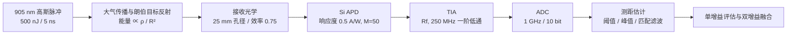

分层的目的是逐级校验：光学层以距离平方反比校验，探测器层以量子效率闭环校验，TIA 层以直流增益与等效噪声带宽校验，ADC 层以量化误差上界校验。自动化测试围绕上述不变量设计。

### 4.2 光学链路

发射脉冲采用能量归一化高斯模型，脉宽以 $\tau_{\mathrm{FWHM}}=5\ \mathrm{ns}$ 给定，其与高斯标准差的关系为：

```math
\sigma
=
\frac{\tau_{\mathrm{FWHM}}}
{2\sqrt{2\ln 2}}
```

目标距离为 $R$ 时，回波往返时延为：

```math
t_r=\frac{2R}{c}
```


在同轴远场、朗伯反射且接收视场完全覆盖光斑的条件下，接收脉冲能量可表示为若干物理因子的乘积：


```math
E_r
=
E_t\,\eta_t\,f_{\mathrm{fill}}\,\rho\,\cos\theta
\left(\frac{A_r}{\pi R^2}\right)
\exp\left(-2\alpha R\right)\eta_r
```


各项依次为发射能量 500 nJ、发射效率 0.85、目标填充比、反射率 ρ、入射角余弦、接收孔径面积（25 mm 口径）、距离平方反比、双程大气衰减 $\exp(-2\alpha R)$，其中 $\alpha=1\times10^{-4}\ \mathrm{m}^{-1}$ 与接收光学效率 0.75。该分解方式便于在获得实测参数后逐项替换。

模型校验：关闭大气衰减后，对 1–150 m 的接收能量作双对数拟合，斜率为 −2.000，与距离平方反比关系一致；同时验证了接收能量与反射率的线性关系，以及脉冲波形的时间积分等于设定能量。

50 m 处光斑直径约 53 mm、面积约 22 cm²，远小于 10 m² 的目标投影面积，填充比为 1。该简化在近距离小目标场景下不再成立，需按光斑与目标的实际交叠重新计算。

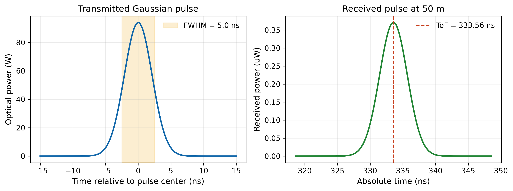

*图 1　发射脉冲与 50 m 处回波波形。左：500 nJ、5 ns 发射脉冲；右：50 m、10% 反射率目标回波，峰值约 0.36 µW，往返时延 333.56 ns。能量由 500 nJ 衰减至 1.972 fJ，跨越 8 个数量级。*

### 4.3 APD 探测

905 nm 单光子能量为 2.195×10⁻¹⁹ J，1.972 fJ 对应约 8986 个入射光子。

APD 响应度取 0.50 A/W，对应外量子效率 η_q = R·hc/(qλ) ≈ 68.5%，平均初级光电子数为 6155。倍增增益 M = 50，采用 McIntyre 模型计算过剩噪声因子：

APD过剩噪声因子采用McIntyre模型：

```math
F(M)
=
kM+(1-k)\left(2-\frac{1}{M}\right)
```

当 $M=50$、$k=0.02$ 时：

```math
F(50)=2.94
```

倍增增益 50 并不等于信噪比提升 50 倍。噪声随信号一同放大，APD倍增增益并不等于信噪比等比例提升。增益 $M$ 能够提高信号相对于后级TIA电子噪声的幅度，但APD散粒噪声也会随倍增过程放大，并受到过剩噪声因子$F(M)$ 的影响。因此，增大 $M$ 的主要作用是使弱光电流高于后级电子噪声，而不是无限提高散粒噪声受限条件下的信噪比。这是雪崩倍增的固有代价，也说明单纯提高 M 无法解决灵敏度问题。

背景光按光谱辐亮度与接收展度估算：0.30 W/(m²·sr·nm) × 4.91×10⁻⁴ m² 孔径 × 2 mrad 视场立体角 × 10 nm 滤光片带宽 × 0.75 光学效率 ≈ 3.47 nW。该值较基线回波低两个数量级，但在 200 m 处回波峰值仅二十余纳瓦，背景光与信号已处于同一量级，构成远距离散粒噪声的主要来源。

表 1　50 m、10% 反射率条件下的探测器基线结果

| 指标 | 数值 |
|---|---:|
| 接收脉冲能量 | 1.972 fJ |
| 接收光子数 | 8985.8 |
| APD 量子效率 | 68.500% |
| 初级光电子数 | 6155.3 |
| 倍增峰值电流 | 9.265 µA |
| 散粒噪声受限峰值 SNR | 27.551（线性值，约 28.8 dB） |

表中 27.551 为线性比值，仅计入 APD 散粒噪声，不含 TIA 热噪声，描述探测器自身的性能上限；后文 TIA 输出端的峰值信噪比（26.409 dB）含义不同，二者不可直接比较。

需要说明，背景辐亮度为系统级假设，并非由 100 klx 照度直接换算。照度到辐亮度需经太阳光谱与视见函数加权，直接换算是此类仿真中常见的误差来源。

### 4.4 跨阻放大

TIA 采用一阶低通模型：通带跨阻 R_f，−3 dB 带宽 f_c，等效噪声带宽 B_ENBW = (π/2)·f_c。噪声源包含四项，按功率叠加后对 B_ENBW 积分：

- APD 散粒噪声，含信号、背景、暗电流、增益与过剩噪声因子；
- TIA 输入电流噪声密度 3 pA/√Hz；
- 反馈电阻热噪声 √(4kT/R_f)，20 kΩ 时约 0.91 pA/√Hz；
- 输出噪声折算至输入端的等效电流噪声。

带宽升高同时带来两方面影响：脉冲展宽与峰值延迟减小，有利于时间信息保真；等效噪声带宽增大，输出噪声上升，峰值信噪比下降。带宽选型即在两者之间确定折中点。

表 2　跨阻带宽对输出波形与信噪比的影响

| 带宽 | 峰值 | 噪声 RMS | 峰值 SNR | 输出 FWHM | 峰值延迟 |
|---:|---:|---:|---:|---:|---:|
| 100 MHz | 156.861 mV | 5.389 mV | 29.280 dB | 5.778 ns | 1.220 ns |
| **250 MHz** | **178.209 mV** | **8.521 mV** | **26.409 dB** | **5.189 ns** | **0.590 ns** |
| 500 MHz | 183.305 mV | 12.050 mV | 23.644 dB | 5.053 ns | 0.310 ns |

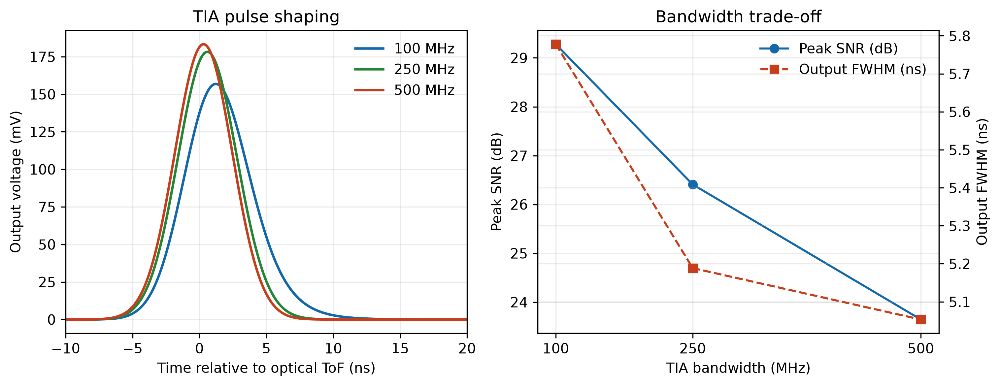

*图 2　跨阻带宽对波形、峰值信噪比与脉宽的影响。左：三档带宽下 TIA 输出脉冲的成形效果；右：峰值信噪比与输出 FWHM 随带宽的变化。*

由表 2，带宽由 100 MHz 增至 250 MHz，输出 FWHM 由 5.778 ns 降至 5.189 ns、峰值延迟由 1.220 ns 降至 0.590 ns，代价为峰值信噪比下降 2.87 dB；由 250 MHz 增至 500 MHz，峰值信噪比再降 2.77 dB，而 FWHM 仅再减小 0.136 ns、延迟仅再降低 0.280 ns。第二段的收益递减十分明显，250 MHz 位于该折中曲线的拐点。

另一项约束来自发射脉冲本身：5 ns 脉宽决定了回波的有效带宽，前端带宽继续提高，采到的仍是一段本已平缓的波形。

### 4.5 ADC 采样与量化

ADC 的原始距离间隔由 ΔR = c/(2f_s) 确定，1 GHz 对应 14.99 cm，2 GHz 对应 7.50 cm。该间隔描述采样网格的疏密，并非测距精度。

表 3　采样率对原始距离间隔与最坏相位峰值误差的影响

| 采样率 | 采样周期 | 原始距离间隔 | 最坏相位峰值误差 |
|---:|---:|---:|---:|
| 250 MHz | 4.000 ns | 59.958 cm | 33.354% |
| 500 MHz | 2.000 ns | 29.979 cm | 9.631% |
| **1 GHz** | **1.000 ns** | **14.990 cm** | **2.500%** |
| 2 GHz | 0.500 ns | 7.495 cm | 0.580% |

表中最后一列为峰值落在两采样点正中间时由采样引起的幅度误差。1 GHz 时为 2.5%，500 MHz 时为 9.6%，后者已足以使峰值位置产生明显偏移，这是选择 1 GHz 的直接依据。

位宽方面，在 0–0.25 V 量程下：

表 4　量化位数对 LSB 与量化噪声的影响

| 位宽 | LSB | 量化 RMS |
|---:|---:|---:|
| 8 bit | 0.9804 mV | 0.1477 mV |
| **10 bit** | **0.2444 mV** | **0.0484 mV** |
| 12 bit | 0.0611 mV | 0.0128 mV |

10 bit 的量化 RMS 为 0.0484 mV，模拟前端噪声为 8.521 mV，二者相差约 176 倍，量化噪声在该系统中可忽略。10 bit 的选择并非勉强满足指标，而是继续提高位数已无实际收益。

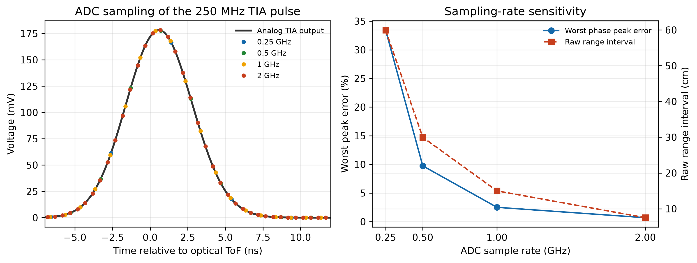

*图 3　采样率对波形离散化与峰值误差的影响。左：不同采样率对同一波形的离散化效果；右：最坏峰值误差与原始距离间隔随采样率的变化。*

需要记录一项实现细节：初始 ADC 量程设为 0–0.25 V，零均值噪声在下轨被削顶，引入系统性偏差；改为 −0.05–0.25 V 后该问题消除。

### 4.6 测距算法

比较四种测距方法：

- **固定阈值**：取回波上升沿首次越过门限的时刻，相邻采样点间线性插值。计算量最小，但触发时刻随回波幅度变化，存在幅度走动。
- **整数峰值**：取最大采样点的位置，精度受采样网格限制。
- **三点抛物线插值**：在峰值及相邻两点间拟合抛物线，以顶点偏移给出亚采样修正。
- **匹配滤波**：以已知发射波形作相关运算，取相关峰并施加同样的亚采样修正。

抛物线修正的表达式为：

抛物线插值的亚采样偏移量为：

```math
\delta
=
\frac{1}{2}
\frac{y[n-1]-y[n+1]}
{y[n-1]-2y[n]+y[n+1]}
```


因此，修正后的峰值时间为：

```math
\hat{t}
=
t_n+\delta T_s
```


其中，$`t_n`$ 为最大采样点对应的时间，
$`T_s`$ 为 ADC 采样周期。


为保证可比性，各方法先用无噪声基线波形标定固定模拟延迟（对应产线标定），再在相同随机种子下各进行 2000 次蒙特卡洛仿真。模板取自峰值前后各 10 个采样点，共 21 点，并作去均值与能量归一化。

表 5　四种测距算法的蒙特卡洛统计结果（50 m、10% 反射率，2000 次）

| 算法 | 检出率 | Bias | RMSE | P95 绝对误差 |
|---|---:|---:|---:|---:|
| 固定阈值 | 100% | −0.457 cm | 3.316 cm | 6.666 cm |
| 整数峰值 | 100% | −6.175 cm | 8.877 cm | 16.971 cm |
| 抛物线峰值 | 100% | −0.035 cm | 3.593 cm | 7.238 cm |
| **匹配滤波** | **100%** | **0.007 cm** | **1.173 cm** | **2.302 cm** |

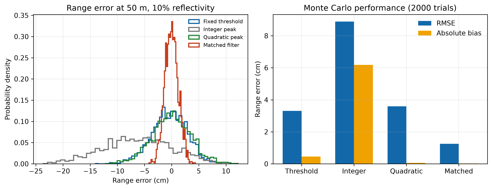

*图 4　四种测距算法的误差分布与统计结果。左：误差概率密度；右：RMSE 与绝对偏差的对比。*

结果分析如下。

（1）整数峰值的 Bias 为 −6.175 cm，约合 0.4 个采样格，误差中存在明显的系统分量。其主要来源为标定方式：标定仅使用相位为 0 的单次采样，该次采样中最近格点相对真实峰值偏移约 6 cm；由于各次试验的采样相位随机，该固定偏移被整体引入误差分布。由此可知，以单次无噪声波形标定会将当次采样相位偏差固化。

（2）固定阈值与抛物线插值的 RMSE 分别为 3.316 cm 与 3.593 cm，量级接近而成因不同：前者源于幅度走动，后者源于噪声对三点拟合的扰动。

（3）匹配滤波的 Bias 为 0.007 cm、RMSE 为 1.173 cm，较整数峰值改善约 7.5 倍。该结果说明 15 cm 的采样间隔是估计量的网格粒度，而非精度上限；在信噪比充分、波形形状已知的条件下，相关峰位置可通过多点拟合估计至远小于一个网格。

上述结论依赖当前的 SNR、固定模板、准确标定与白噪声假设。信噪比下降或模板失配时，插值带来的增益将显著收窄。

## 5 单增益接收机的动态范围分析

将跨阻（5/10/20 kΩ）与 ADC 正满量程（0.25/0.5/1.0 V）交叉组合，对各条件分别进行蒙特卡洛仿真，结果见表 6。

表 6　跨阻与 ADC 满量程联合扫描结果

| R_f | ADC +FS | 10% 可靠远距 | 80% 最小无饱和距离 | 50 m RMSE |
|---:|---:|---:|---:|---:|
| 5 kΩ | 0.25 V | 140 m | 70 m | 1.298 cm |
| 5 kΩ | 1.00 V | 140 m | 40 m | 1.317 cm |
| 10 kΩ | 0.50 V | 150 m | 70 m | 1.249 cm |
| 20 kΩ | 0.50 V | 150 m | 90 m | 1.218 cm |
| 20 kΩ | 1.00 V | 160 m | 70 m | 1.245 cm |

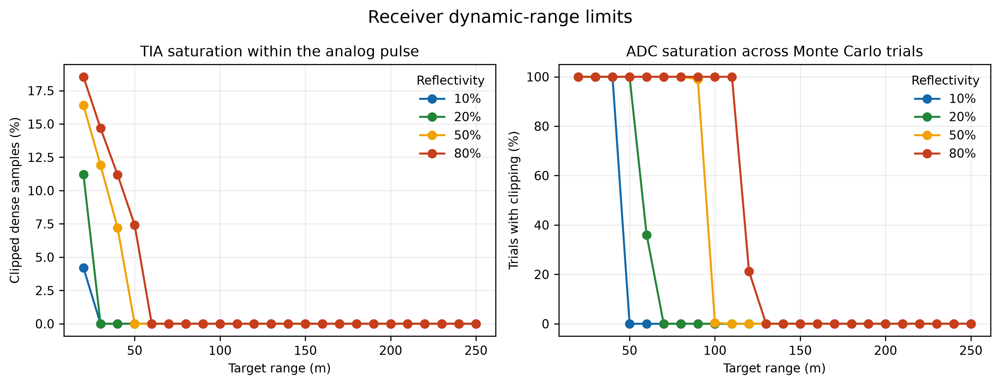

*图 5　单增益接收机的 TIA 与 ADC 饱和边界。左：TIA 中被削顶的采样比例随距离的变化；右：ADC 削顶的试验比例。*

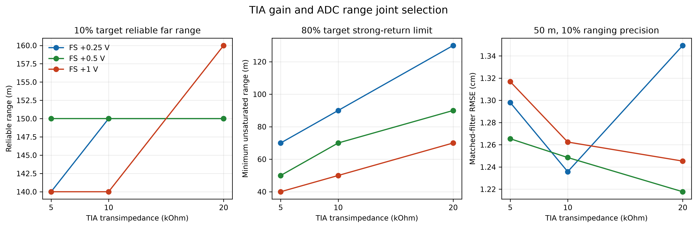

*图 6　跨阻与 ADC 满量程的联合选型结果。左：10% 目标的可靠远距；中：80% 目标的最小无饱和距离；右：50 m 处测距 RMSE。*

在 50 m 弱目标条件下，各组合的 RMSE 介于 1.218–1.317 cm，差异不足 8%。跨阻与量程的搭配对弱目标精度影响有限，原因是弱目标精度主要由 SNR 决定，而 SNR 主要由 APD 与背景光决定。

差异主要体现在80%目标的最小无饱和距离：5 kΩ/0.25 V为70 m，5 kΩ/1.0 V可改善至40 m，而20 kΩ/0.5 V需到90 m后才退出饱和。降低跨阻并扩大ADC量程能够改善近场动态范围，但会降低弱回波电压与码字利用率。

量化噪声在各组合中最高为模拟噪声的 15.8%，进一步表明 ADC 位宽不是当前瓶颈。

综上，单增益接收机的限制来自架构本身：一个增益需同时服务两类目标，在物理上不成立，其结果只能在远距与近距之间二选一。

## 6 双增益接收机设计

### 6.1 架构选型

解决动态范围问题有以下几条常见路径：

- **自动增益控制（AGC）**：检测到过载后切换跨阻。硬件开销较小，但切换需要时间，而 dToF 回波仅持续数纳秒，检测到过载时回波已经结束。过载恢复时间在本模型中尚未建模，AGC需要先检测过载，再调整增益，其响应与过载恢复时间取决于具体电路。由于单次dToF回波仅持续数纳秒，AGC通常无法在同一回波内完成闭环调整；本项目尚未建立动态AGC模型，因此未将其纳入定量对照。
- **对数放大器**：压缩动态范围，但改变波形形状，破坏匹配滤波所依赖的模板。
- **并行双通道**：两路同时接收与采样，事后择一。硬件开销加倍，但不存在切换延迟，两路获取的是同一回波的两个副本。

本项目采用并行双通道方案。其代价是可量化的硬件开销，其收益与 dToF 体制的时间尺度直接相关。

### 6.2 通道参数与融合逻辑

高增益通道取 R_f = 20 kΩ，承担远距弱回波；低增益通道取 R_f = 2 kΩ，承担近距强回波。两路共用同一 APD 电流与同一采样时钟相位，ADC 量程统一为 −0.2–1.0 V。

低增益通道跨阻取 2 kΩ 的依据如下：20 m、80% 回波在 20 kΩ 下需 8.9 V，在 5 kΩ 下为 2.23 V，均超出 1.0 V 满量程；取 2 kΩ 时峰值为 0.891 V，位于量程之内。跨阻继续降低将损失弱信号能力，取值更高则无法覆盖最近、最强的回波。

融合规则如下：

融合逻辑只使用通道饱和状态和匹配滤波检测结果，不使用仿真真实距离：

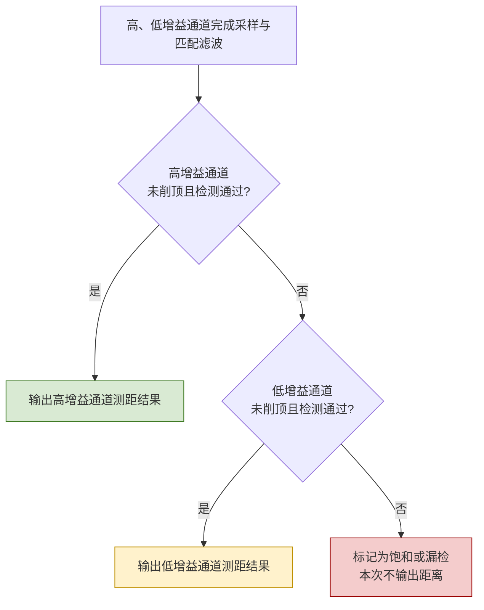
通道判定条件为：

- **未削顶：** TIA输出未触及设定摆幅，且ADC采样值未触及满量程；
- **检测通过：** 匹配滤波相关峰超过 $5\sigma$ 门限；
- **优先级：** 高增益通道优先，以保留弱回波测距精度；仅在高增益通道饱和或未检出时切换至低增益通道；
- **失败处理：** 两个通道均不满足条件时，不输出距离结果。


“未削顶”指 TIA 输出未触及 ±1 V 摆幅且 ADC 未触顶；“检出”指匹配滤波相关峰超过 5σ。规则中不包含真实距离。

### 6.3 模型修正

双增益验证过程中，初版模型存在两处设定不符合物理实际或工程可实现性。修正后结论发生变化，该过程对结果可信度具有直接影响，故单独说明。

**6.3.1 真值泄漏**

初版融合逻辑在判断通道有效性时使用了仿真真值，即估计值与真实 ToF 足够接近才判为有效。该做法在实机上不可实现，且会在两通道均不可靠时给出实机无法做出的选择，从而系统性高估融合性能。

修正后，有效性判断仅使用削顶状态与相关峰门限两项可观测量；真值保留在评分环节，用于判定通道选择是否正确。选中通道的估计与真值偏差超过 5 ns 的样本单独记为错误时间选择，不计入成功检出，并在数据与图中单独统计。

**6.3.2 噪声相关性**

两通道接收同一 APD 输出的同一回波，APD 散粒噪声为共享噪声源，仅 TIA 内部噪声相互独立。初版为两通道分别生成独立噪声序列并独立随机化采样相位，等价于允许融合逻辑通过多次独立尝试获得额外优势，会高估双通道收益。

修正后的设定为：

- 每次试验仅抽取一个采样相位，两通道共用；
- 每次试验仅抽取一条标准高斯序列作为 APD 噪声，按各通道跨阻缩放后共用；
- TIA 内部噪声仍按两通道独立抽取；
- 各通道以自身噪声 RMS 确定检出门限。

实现上先将总噪声方差分解为 APD 分量与 TIA 分量，再分别合成。该处理仍为白噪声与采样域近似，未刻画模拟域噪声的时间相关性与通道间串扰，但对双增益架构收益的评估更为保守。

### 6.4 仿真结果

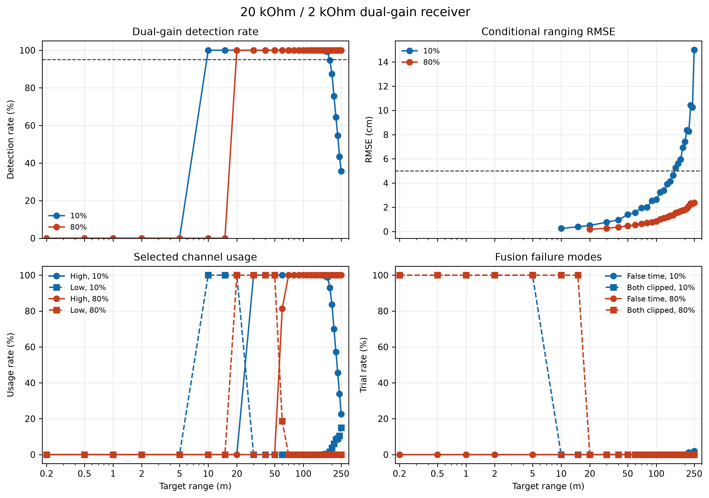

*图 7　双增益接收机的检出率、RMSE、通道使用率与失败模式。*

表 7　双增益接收机的近远场覆盖与通道使用情况

| 反射率 | 可靠仿真区间 | 低增益主导范围 | 双通道同时饱和区 |
|---:|---:|---:|---:|
| 10% | 10–150 m | 约10–20 m | 约0.2–5 m |
| 80% | 20–250 m | 约20–50 m | 约0.2–15 m |

近距端：20 m、80% 回波使高增益通道饱和，低增益通道以 0.891 V 的峰值正常工作，融合逻辑选择低增益通道。随距离增加，回波减弱，低增益通道信噪比首先不足，高增益通道恢复可用，通道交接发生在 20–60 m 之间：低增益通道先独占，随后逐步让出，最终由高增益通道完全承担。

远距端：10%反射率目标在150 m内满足可靠判据，160 m后不再同时满足检出率不低于95%和条件RMSE不超过5 cm，因此可靠区间止于150 m。80%目标在250 m扫描边界仍满足可靠判据。

失败模式：错误时间选择仅出现在弱信号远端，190 m 后开始出现，250 m 处达到最大值 1.6%；双通道同时饱和的比例全程为 0。该分布表明，远端的失效原因是信噪比不足，而非动态范围不足。

需要指出，80% 反射率目标在 250 m 处满足判据，仅说明其在扫描网格边界上通过，不表示 250 m 为其量程上限。

### 6.5 近场饱和与通道交接

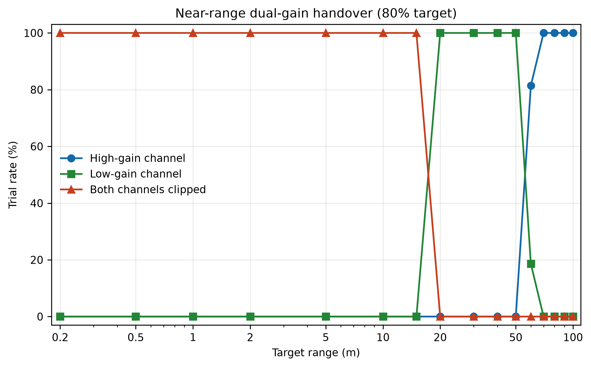

*图 8　80%反射率目标的近场强回波饱和与双增益交接。在当前离散扫描网格下，0.2–15 m范围内两个通道均饱和，20–50 m由2 kΩ低增益通道接管，约60 m后切换至20 kΩ高增益通道。*

### 6.6 与单增益架构对照

表 8　三种接收架构的可靠距离区间

| 接收架构 | 10%目标 | 20%目标 | 50%目标 | 80%目标 |
|---|---:|---:|---:|---:|
| 单20 kΩ | 30–150 m | 40–220 m | 50–250 m | 70–250 m |
| 单2 kΩ | 10–120 m | 10–170 m | 20–250 m | 20–250 m |
| **20/2 kΩ双增益** | **10–150 m** | **10–220 m** | **20–250 m** | **20–250 m** |

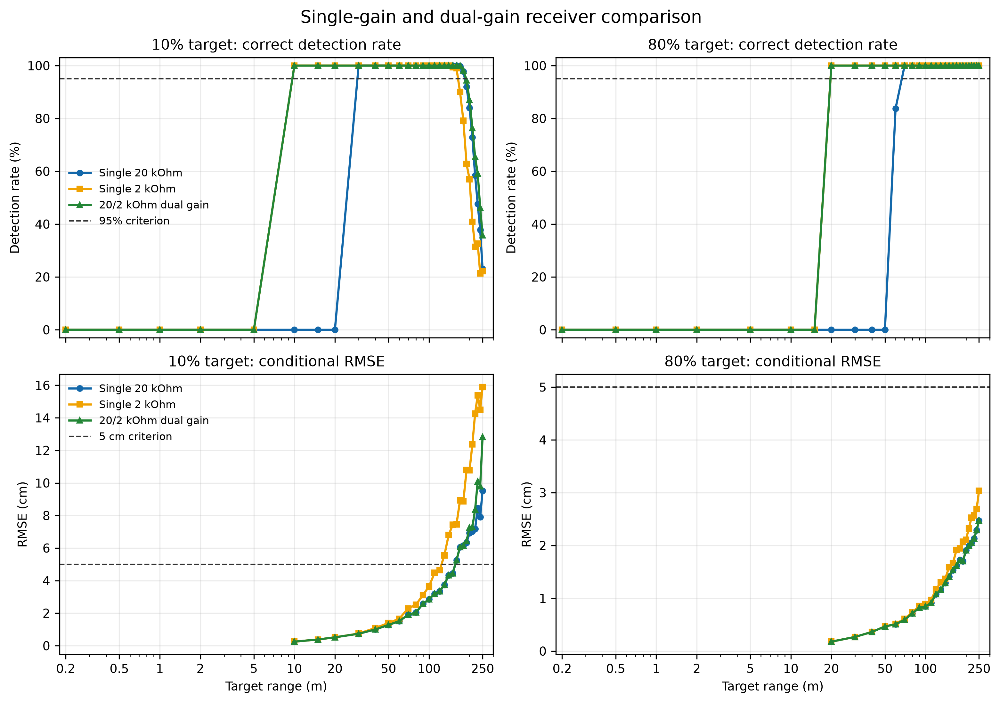

*图 9　三种接收架构在10%和80%反射率条件下的检出率与条件RMSE对照。*

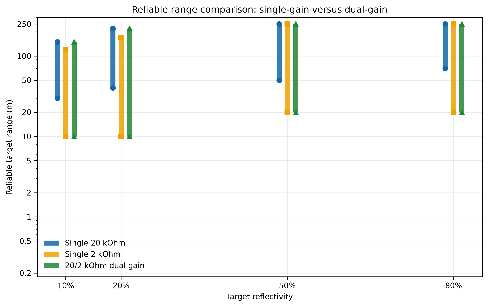

*图 10　三种接收架构在不同反射率下的可靠距离区间。双增益方案组合了低增益通道的近场覆盖与高增益通道的远场能力。*

## 7 结论与后续工作

### 7.1 主要认识

（1）系统级设计中，优化资源应投向主导误差项。本项目将 ADC 位宽由 8 bit 提高至 12 bit，量化噪声下降约 11 倍，整机测距精度基本不变，原因是量化噪声自始不是主导项；而动态范围通过一次联合扫描即可确认为真正的瓶颈。

（2）局部最优不等于系统最优。250 MHz 在信噪比上不及 100 MHz，在波形保真度上不及 500 MHz，但它是两端损失均可接受的位置；20 kΩ 在远距最优、在近距最差，因此最终方案不是二选一，而是并行配置。

（3）模型结论必须与其假设条件同时给出。1.173 cm 的 RMSE 仅在与 50 m、10% 反射率、2000 次蒙特卡洛、白噪声与固定模板等条件同时成立时有效。可复用的是方法与适用边界，而非单一数值。

### 7.2 模型局限

**参数尚未绑定器件。** 激光能量、APD 响应度与增益、TIA 噪声密度、ADC 采样率目前均为设计基线，未对应具体型号与数据手册页码。各参数按来源等级登记（设计值、设计基线、文献值、简化假设），正式选型时须逐项替换为手册值并记录页码。

**物理模型经过简化。** 目标为朗伯平面，接收为同轴远场且回波被完全接收；大气仅考虑均匀消光，未包含雨雾与多径；背景光为参数化光谱辐亮度，非实测太阳光谱；噪声为采样域白噪声，未包含 1/f 成分、时间相关性与电源干扰。

**电路模型为一阶近似。** TIA 采用单极点低通模型，未包含 APD 结电容、运放稳定性、过载恢复时间与 PCB 寄生参数；ADC 为理想量化器，未包含 ENOB、孔径抖动、非线性与时钟相噪。

**无硬件验证，亦未进行眼安全评估。** IEC 60825-1 的合规性不能由脉冲能量推算，须按实际光路与重复频率单独评估。

### 7.3 后续工作

1. **绑定真实器件**：选定具体的激光器、APD/TIA 与 ADC，将数据手册中的典型值与极限值写入参数库，并记录型号、版本与页码。
2. **补充关键非理想项**：过载恢复时间（决定 AGC 类方案是否可行）、APD 结电容对带宽的影响、ADC 的 ENOB 与抖动、温度漂移。
3. **实测标定**：使用脉冲激光器、目标板与示波器采集不同距离、反射率与环境光下的回波波形，对模型预测与实测波形作残差分析，以检验当前假设的有效性。

## 附录 A　基线参数

表中“来源”一列说明该值当前的可信级别：**设计**指可自由优化的系统参数；**设计基线**指按典型器件水平取定的工作点，待在选型时替换；**文献**指取自公开模型的经验值；**简化**指建模假设，不对应任何器件保证。

| 类别 | 参数 | 取值 | 来源 |
|---|---|---:|---|
| 激光 | 波长 | 905 nm | 设计 |
| | 脉冲能量 / FWHM | 500 nJ / 5 ns | 设计 |
| | 初始光束直径 / 发散角 | 3 mm / 1 mrad（全角） | 设计 |
| | 发射效率 | 0.85 | 简化 |
| 目标 | 投影面积 / 入射角 | 10 m² / 0° | 简化 |
| 信道 | 大气消光系数 | 1×10⁻⁴ /m | 简化 |
| 接收 | 孔径 / 光学效率 | 25 mm / 0.75 | 设计 / 简化 |
| 背景 | 光谱辐亮度 | 0.30 W/(m²·sr·nm) | 简化 |
| | 视场 / 滤光片带宽 | 2 mrad / 10 nm | 设计 |
| APD | 响应度 / 增益 | 0.50 A/W / 50 | 设计基线 |
| | 电离比 / 暗电流 | 0.02 / 5 nA | 文献 / 设计基线 |
| TIA | 跨阻 / 带宽 | 20 kΩ / 250 MHz | 设计 |
| | 输入电流噪声 / 输出噪声 | 3 pA/√Hz / 5 nV/√Hz | 设计基线 |
| | 输出摆幅 | ±1.0 V | 设计 |
| ADC | 采样率 / 位宽 | 1 GHz / 10 bit | 设计 |
| | 量程（单通道 / 双增益） | −0.05–0.25 V / −0.2–1.0 V | 设计 |
| 双增益 | 高 / 低跨阻 | 20 kΩ / 2 kΩ | 设计 |

## 附录 B　复现方法

```bash
python3.12 -m venv .venv
source .venv/bin/activate
python -m pip install -e '.[dev]'
python -m pytest -v

python scripts/run_baseline.py                 # 光学链路基线
python scripts/run_optical_validation.py       # 距离平方反比校验与能量扫描
python scripts/run_detector_baseline.py        # APD 基线
python scripts/run_tia_bandwidth_study.py      # 带宽选型
python scripts/run_adc_study.py                # 采样率与位宽
python scripts/run_ranging_study.py            # 四种测距算法
python scripts/run_range_performance_sweep.py  # 距离与反射率扫描
python scripts/run_frontend_selection.py       # 跨阻与满量程联合选型
python scripts/run_dual_gain_study.py          # 双增益验证
python scripts/run_architecture_comparison.py  # 单增益与双增益架构对照
```

所有蒙特卡洛脚本使用固定随机种子，CSV 输出至 `results/data/`，PNG 与 PDF 图输出至 `results/figures/`。测试覆盖能量积分、ToF 关系、距离平方反比、量子效率、噪声带宽、TIA 直流增益与削顶、ADC 采样与量化上界、阈值与亚采样峰值定位、匹配滤波、可靠区间判定与融合逻辑，目前约 30 项全部通过。

## 附录 C　目录结构

```text
configs/            系统设计参数（YAML）
src/lidar_sim/      光学、探测器、TIA、ADC、测距模型
scripts/            可复现实验脚本
results/data/       数值输出（CSV）
results/figures/    成图（PNG/PDF）
tests/              物理与数值一致性测试
docs/               模型推导与参数来源
```

---

*本报告全部结果为仿真预测。引用其中的数值时，应同时引用第 7.2 节的模型边界。*
