# Simulation and Dual-Gain Design of dToF LiDAR Receivers for Wide-Dynamic-Range Ranging

## Summary

This report addresses the receiver design of a 905 nm pulsed direct time-of-flight (dToF) LiDAR. The design problem is a dynamic-range problem: one receiver must detect low-reflectivity targets at long range while remaining unsaturated on high-reflectivity returns at short range. The study quantifies the trade-offs among transimpedance gain, analog bandwidth, ADC sampling, and ranging estimation, and evaluates a dual-gain architecture intended to cover both ends of the operating envelope.

The work is a system-level simulation study. The model spans the transmit pulse, atmospheric propagation and Lambertian reflection, receiver optics, a silicon avalanche photodiode (APD), a transimpedance amplifier (TIA), an analog-to-digital converter (ADC), and the ranging estimator. Each stage is described by physical equations, and automated tests verify the consistency of the chain.

Principal results: at 50 m and 10% reflectivity, the received pulse energy is
1.972 fJ, corresponding to approximately 8,986 photons and 6,155 primary
photoelectrons. A 250 MHz TIA, a 1 GHz 10-bit ADC, and matched filtering with
sub-sample peak estimation achieve a ranging RMSE of 1.173 cm under the baseline
simulation condition.

A receiver-architecture comparison shows that a single 20 kΩ channel covers
30–150 m for a 10% target and 40–220 m for a 20% target, whereas a single
2 kΩ channel covers 10–120 m and 10–170 m, respectively. The 20 kΩ/2 kΩ
dual-gain receiver combines their advantages, extending the reliable intervals
to 10–150 m for 10% reflectivity and 10–220 m for 20% reflectivity. Targets
with 50% and 80% reflectivity remain reliable over 20–250 m on the simulated
grid.

The 250 m endpoint is the upper boundary of the simulated grid and must not be
interpreted as a measured maximum range.

All values are predictions of the present model under its stated assumptions. They are not hardware measurements and do not constitute component specifications. Throughout this report, "250 m" denotes the upper edge of the simulated range grid rather than a maximum range, and "reliable" means a detection rate of at least 95% together with a conditional RMSE of at most 5 cm.

## 1 Key findings

1. **Dynamic range, rather than ADC resolution, is the primary receiver limitation.** In the 20 kΩ narrow-range baseline, the 10-bit quantization RMS is approximately 0.57% of the analog-noise RMS. Across the complete transimpedance and ADC-range sweep, the ratio reaches at most 15.8%, but remains secondary to analog noise and strong-return saturation.
2. **A 250 MHz TIA, 1 GHz sampling, and 10-bit resolution form a consistent baseline** for a 5 ns pulse: the penalty paid in each dimension (noise, waveform fidelity, data rate) is bounded and acceptable.
3. **The 15 cm range bin is not the 15 cm accuracy limit.** At 1 GHz the bin spacing is 14.99 cm; matched filtering with sub-sample interpolation reduces the baseline RMSE to 1.173 cm over 2,000 Monte Carlo trials.
4. **A single-gain receiver cannot cover both ends of the operating range.**
The single 20 kΩ channel preserves weak-return sensitivity but does not become reliable until 30 m for a 10% target and 70 m for an 80% target. The single 2 kΩ channel improves near-range coverage but shortens the reliable far range of low-reflectivity targets.
5. **The 20 kΩ/2 kΩ dual-gain architecture combines the reliable regions of
   both single-gain channels.** The reliable interval becomes 10–150 m for 10% reflectivity and 10–220 m for 20% reflectivity. For 50% and 80% targets, the simulated reliable interval is 20–250 m. Near-range screening shows that an 80% target clips both channels from 0.2 m to 15 m, is handled by the low-gain channel from approximately 20 m to 50 m, and transitions to the high-gain channel at approximately 60 m.


## 2 Problem statement

### 2.1 Origin of the dynamic-range requirement

A dToF sensor recovers range from the round-trip delay of a short pulse, so the design is governed by the strength of the return. Received energy scales with target reflectivity and with the inverse square of range. Relative to the 50 m, 10% baseline, a 20 m, 80% target returns 50 times more energy while a 200 m, 10% target returns 1/16 as much: a spread of 800:1, or approximately 29 dB.

The usable dynamic range of the receiver is narrower than this spread because it is bounded by the TIA output swing and the ADC full-scale range (FSR). At 20 kΩ, the 50 m, 10% return appears as 178 mV at the TIA output, comfortably inside the linear region. The 20 m, 80% return would require 8.9 V to remain unclipped, whereas the TIA swing is ±1 V. A gain chosen for weak long-range returns therefore overloads on strong short-range returns. This is an architectural constraint of a single-gain channel and cannot be removed by re-tuning.

### 2.2 Design questions

1. What TIA bandwidth balances pulse fidelity against integrated noise?
2. What sample rate and resolution should the ADC have, and does the 15 cm bin spacing set an accuracy limit?
3. Given that a single gain cannot work, how should a dual-gain receiver be structured, and how can its benefit be verified?

## 3 Evaluation criteria and method

### 3.1 Reliability criterion

A condition is called reliable only when both requirements are met:

- detection rate ≥ 95%;
- conditional ranging RMSE ≤ 5 cm, computed over successfully detected trials only.

The conditional form matters. If ranging error is reported without the detection rate, an estimator can obtain a low error by rejecting difficult returns, and the number carries no engineering meaning. The two metrics are therefore always reported together.

In addition to detection rate and conditional RMSE, the range–reflectivity
sweep reports an all-trial RMSE. The all-trial metric includes incorrect-peak
selections and trials that fail the detection or timing-validity criteria. It
therefore prevents conditional RMSE from appearing artificially low after
difficult trials have been excluded.

The reliable-range criterion remains based on both detection rate and
conditional RMSE, while the all-trial RMSE is reported as an additional
failure-sensitive metric.

### 3.2 Detection threshold and wrong-time selection

Detection requires the matched-filter correlation peak to reach five times the noise RMS. The range sweeps and the dual-gain study apply an additional timing-validity test: an estimate that deviates from ground truth by more than 5 ns
(approximately 75 cm) is excluded from the conditional error statistics and
counted as a wrong-time selection. It remains included in the all-trial RMSE.
This separates gross failures from ordinary precision loss without hiding them
from the overall performance metric.


### 3.3 Monte Carlo settings

Each range and reflectivity condition is evaluated independently with a fixed random seed. The number of trials depends on the experiment: 2,000 for the estimator comparison, 500 for the dual-gain study, and 200 (screening) or 500 (50 m baseline) for the joint front-end selection. 
Noise is represented by additive Gaussian samples. In the single-channel
experiments, the receiver noise is generated directly from the total RMS value.
In the dual-gain experiment, the APD shot-noise component and ADC sampling phase
are shared by both channels, while the TIA-internal noise components are
generated independently.


## 4 System model

### 4.1 Model decomposition

The chain is decomposed along the signal path, each stage performing one function and passing its output to the next:

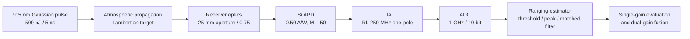

This decomposition makes each stage independently verifiable: the optical link against the inverse-square law, the detector against quantum-efficiency closure, the TIA against DC transimpedance and equivalent noise bandwidth, and the ADC against the quantization error bound. The automated tests are organized around these invariants.

### 4.2 Optical link

The Gaussian standard deviation is related to the pulse FWHM by

```math
\sigma
=
\frac{\tau_{\mathrm{FWHM}}}
{2\sqrt{2\ln 2}}
```

For a target at range $`R`$, the round-trip delay is

```math
t_r=\frac{2R}{c}.
```

For a coaxial far-field geometry with a Lambertian target that fully intercepts
the illuminated footprint, the received pulse energy is

```math
E_r
=
E_t\,\eta_t\,f_{\mathrm{fill}}\,\rho\,\cos\theta
\left(\frac{A_r}{\pi R^2}\right)
\exp\left(-2\alpha R\right)\eta_r.
```


with E_t = 500 nJ, η_t = 0.85, target fill factor f_fill, reflectivity ρ, incidence angle θ, receiver aperture area A_r (25 mm aperture), the inverse-square range term, two-way atmospheric attenuation (α = 1×10⁻⁴ m⁻¹), and receiver optical efficiency η_r = 0.75. Keeping the factors separate allows each to be replaced by a measured value during component selection without disturbing the remainder of the model.

**Validation.** With atmospheric attenuation disabled, a log–log fit of received energy against range from 1 m to 150 m gives a slope of −2.000, matching the inverse-square law. The model also reproduces the linear dependence on reflectivity and the correct time integral of the pulse. These three properties are covered by automated tests, because every downstream conclusion depends on them.

At 50 m the spot is 53 mm in diameter (about 22 cm²), far smaller than the 10 m² target, so the fill factor is unity. This simplification does not hold for small targets at short range, where the overlap between spot and target must be computed explicitly.

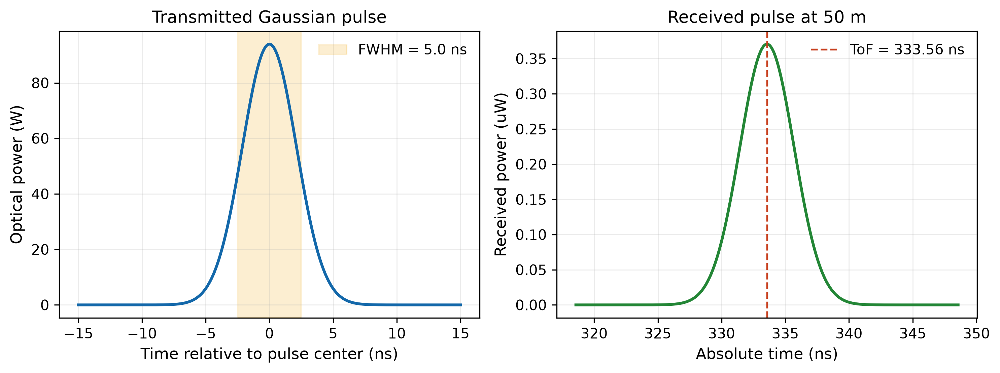

*Figure 1. Transmitted pulse and received return. Left: 500 nJ, 5 ns transmit pulse. Right: return from a 50 m target at 10% reflectivity, with a peak of about 0.36 µW at a round-trip delay of 333.56 ns. The energy falls from 500 nJ to 1.972 fJ, a span of eight orders of magnitude.*

### 4.3 APD detection

A 905 nm photon carries 2.195×10⁻¹⁹ J, so 1.972 fJ corresponds to about 8,986 photons.

At a responsivity of 0.50 A/W, the external quantum efficiency is approximately
68.5%, giving about 6,155 primary photoelectrons. The APD multiplication gain is
$`M=50`$. The McIntyre excess-noise model is

```math
F(M)
=
kM+(1-k)\left(2-\frac{1}{M}\right).
```

For $`M=50,\ k=0.02`$,

```math
F(50)=2.94.
```

An APD gain of 50 does not imply a 50-fold improvement in SNR. Multiplication
raises the signal relative to downstream TIA electronic noise, but APD shot
noise is amplified by the same avalanche process and is further increased by
the excess-noise factor $`F(M)`$. The primary benefit of multiplication is
therefore to raise weak photocurrent above downstream electronic noise, rather
than to provide an unlimited improvement in shot-noise-limited SNR.

Background optical power is estimated from the receiver etendue:

```math
P_{\mathrm{bg}}
=
L_\lambda A_r\Omega_{\mathrm{FOV}}
\Delta\lambda\,\eta_r.
```


for L_λ = 0.30 W m⁻² sr⁻¹ nm⁻¹, A_r = 4.91×10⁻⁴ m², a 2 mrad field of view, and a 10 nm filter. This is two orders of magnitude below the baseline return, but at 200 m the return peak itself is only about 20 nW, so background light becomes comparable to the signal and sets the shot-noise floor at long range.

Table 1. Baseline detector results at 50 m, 10% reflectivity

| Quantity | Value |
|---|---:|
| Received pulse energy | 1.972 fJ |
| Received photons | 8,985.8 |
| APD quantum efficiency | 68.500% |
| Primary photoelectrons | 6,155.3 |
| Multiplied peak current | 9.265 µA |
| Shot-noise-limited peak SNR | 27.551 (linear; ≈ 28.8 dB) |

The value 27.551 is a linear ratio and includes APD shot noise only. It excludes TIA thermal noise and describes the detector alone. The peak SNR quoted later at the TIA output (26.409 dB) is a different quantity, and the two are not directly comparable.

The background radiance is a system-level assumption. It is not converted from an illuminance in klx: that conversion requires the solar spectrum weighted by the photopic response, and omitting it is a common source of error in simulations of this kind.

### 4.4 Transimpedance amplification

The TIA is modeled as a one-pole low-pass stage with passband transimpedance R_f and −3 dB bandwidth f_c, giving an equivalent noise bandwidth of B_ENBW = (π/2)·f_c. Four noise sources are integrated over B_ENBW and summed in power:

- APD shot noise, including signal, background, dark current, gain, and excess noise factor;
- TIA input-current noise density of 3 pA/√Hz;
- feedback-resistor thermal noise √(4kT/R_f), about 0.91 pA/√Hz at 20 kΩ;
- output-voltage noise referred to the input.

Increasing bandwidth shortens the pulse and reduces peak delay, which helps timing fidelity, but widens the noise bandwidth and lowers peak SNR. The bandwidth choice is the compromise between the two.

Table 2. Effect of TIA bandwidth on the output waveform and SNR

| Bandwidth | Peak | Noise RMS | Peak SNR | Output FWHM | Peak delay |
|---:|---:|---:|---:|---:|---:|
| 100 MHz | 156.861 mV | 5.389 mV | 29.280 dB | 5.778 ns | 1.220 ns |
| **250 MHz** | **178.209 mV** | **8.521 mV** | **26.409 dB** | **5.189 ns** | **0.590 ns** |
| 500 MHz | 183.305 mV | 12.050 mV | 23.644 dB | 5.053 ns | 0.310 ns |

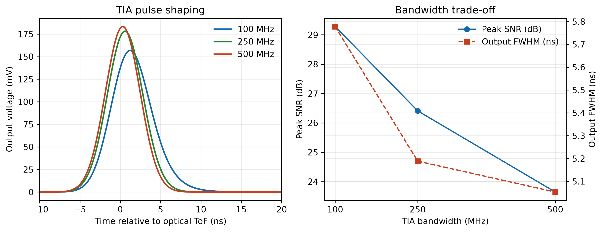

*Figure 2. Effect of TIA bandwidth on waveform, peak SNR, and pulse width. Left: shaped output pulses for three bandwidths. Right: peak SNR and output FWHM versus bandwidth.*

From 100 MHz to 250 MHz the output FWHM falls from 5.778 ns to 5.189 ns and the peak delay from 1.220 ns to 0.590 ns, at a cost of 2.87 dB in peak SNR. From 250 MHz to 500 MHz, peak SNR drops a further 2.77 dB for only 0.136 ns of additional FWHM reduction and 0.280 ns of delay reduction. The trade-off becomes markedly less favorable in the second step, and 250 MHz sits at the knee of the curve.

A wider-bandwidth front end passes a waveform that is already smooth because
the 5 ns source pulse limits the signal bandwidth.


The first-order TIA transfer function is

```math
H(s)
=
\frac{R_f}
{1+s/(2\pi f_c)}.
```

Its equivalent noise bandwidth is

```math
B_{\mathrm{ENBW}}
=
\frac{\pi}{2}f_c.
```

The input-referred thermal-noise density of the feedback resistor is

```math
i_R
=
\sqrt{\frac{4k_{\mathrm{B}}T}{R_f}}.
```


### 4.5 ADC sampling and quantization

The raw range-sampling interval is

```math
\Delta R
=
\frac{c}{2f_s}.
```

At 1 GHz, this interval is 14.99 cm; at 2 GHz, it is 7.50 cm. This is the
spacing of the sampling grid rather than the ranging accuracy.


Table 3. Effect of sample rate on the range bin and worst-case peak error

| Sample rate | Period | Raw range bin | Worst-case peak error |
|---:|---:|---:|---:|
| 250 MHz | 4.000 ns | 59.958 cm | 33.354% |
| 500 MHz | 2.000 ns | 29.979 cm | 9.631% |
| **1 GHz** | **1.000 ns** | **14.990 cm** | **2.500%** |
| 2 GHz | 0.500 ns | 7.495 cm | 0.580% |

The last column is the peak-amplitude error incurred when the return peak falls midway between two samples. It is 2.5% at 1 GHz and 9.6% at 500 MHz; at the lower rate the peak position is displaced enough to matter. This is the direct reason for choosing 1 GHz.

Resolution is evaluated over a 0–0.25 V input range:

Table 4. Effect of resolution on LSB and quantization noise

| Resolution | LSB | Quantization RMS |
|---:|---:|---:|
| 8 bit | 0.9804 mV | 0.1477 mV |
| **10 bit** | **0.2444 mV** | **0.0484 mV** |
| 12 bit | 0.0611 mV | 0.0128 mV |

The 10-bit quantization RMS is 0.0484 mV, compared with 8.521 mV of
analog-noise RMS, giving a ratio of approximately 1:176. Under the baseline
analog-noise assumptions, quantization is therefore not a dominant error source.
Increasing the nominal resolution beyond 10 bits provides little benefit unless
the analog-noise floor is reduced first. 

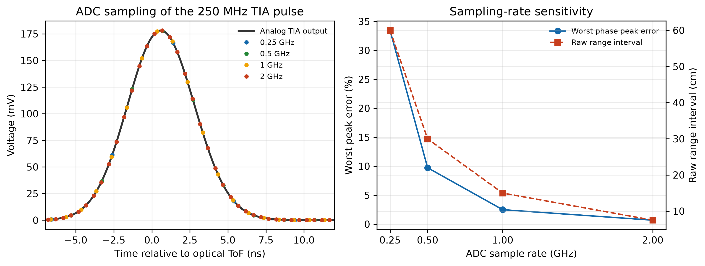

*Figure 3. Effect of sample rate on waveform discretization and peak error. Left: discretization of the same waveform at four rates. Right: worst-case peak error and raw range bin versus sample rate.*

Two implementation details are worth recording. First, the initial ADC input range of 0–0.25 V clipped the zero-mean noise at the lower rail and introduced a systematic offset; the range was changed to −0.05–0.25 V. 
Second, the quantizer uses the endpoint convention

```math
\mathrm{LSB}
=
\frac{V_{\max}-V_{\min}}
{2^N-1}.
```
This differs from the alternative convention
$`\mathrm{FSR}/2^N`$, but ensures that both input rails map to exact codes.


### 4.6 Ranging estimators

Four estimators are compared:

- **Leading-edge threshold.** The first rising-edge crossing, linearly interpolated between adjacent samples. The cheapest to implement, but the trigger time depends on return amplitude, producing walk error.
- **Integer peak.** The largest sample. Resolution is limited to the sampling grid.
- **Three-point parabolic interpolation.** A parabola is fitted through the peak and its two neighbors; the vertex offset gives the sub-sample correction.
- **Matched filter.** Cross-correlation with a known pulse template, followed by the same sub-sample correction.

The sub-sample offset of the three-point parabolic interpolation is

```math
\delta
=
\frac{1}{2}
\frac{y[n-1]-y[n+1]}
{y[n-1]-2y[n]+y[n+1]}.
```

The refined peak time is

```math
\hat{t}
=
t_n+\delta T_s,
```

where $`t_n`$ is the time of the maximum ADC sample and $`T_s`$ is the ADC
sampling period.


For a fair comparison, each estimator is first calibrated against a noiseless baseline waveform to remove a fixed analog delay (representing factory calibration), and then evaluated over 2,000 Monte Carlo trials with the same seed. The template spans 21 samples, ten either side of the peak, and is mean-removed and energy-normalized.

Table 5. Monte Carlo results for the four estimators (50 m, 10% reflectivity, 2,000 trials); P95 is the 95th-percentile absolute error

| Estimator | Detection rate | Bias | RMSE | P95 absolute error |
|---|---:|---:|---:|---:|
| Leading-edge threshold | 100% | −0.457 cm | 3.316 cm | 6.666 cm |
| Integer peak | 100% | −6.175 cm | 8.877 cm | 16.971 cm |
| Parabolic peak | 100% | −0.035 cm | 3.593 cm | 7.238 cm |
| **Matched filter** | **100%** | **0.007 cm** | **1.173 cm** | **2.302 cm** |

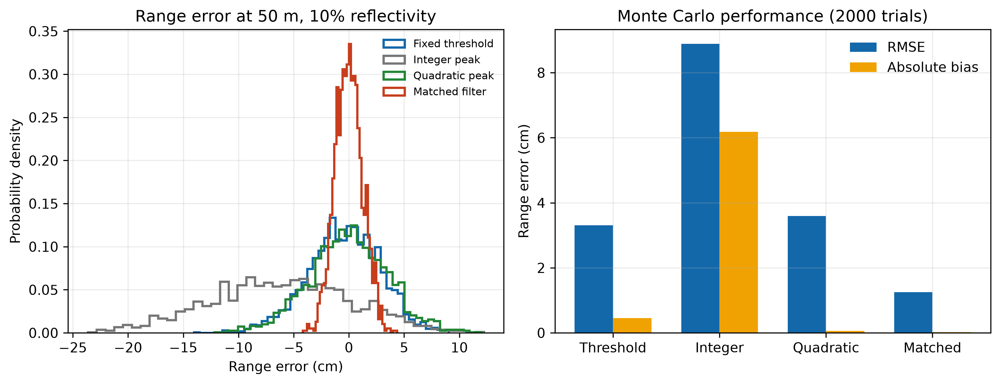

*Figure 4. Error distribution and summary statistics for the four estimators. Left: error probability density. Right: RMSE and absolute bias.*

Three observations follow.

(1) The integer-peak bias is −6.175 cm, about 0.4 of a range bin, so its error contains a systematic component rather than zero-mean jitter. The dominant cause is the calibration: the offset is estimated from a single noiseless record at sampling phase zero, where the nearest grid point happens to sit about 6 cm from the true peak. Because the phase is randomized across trials, that fixed offset shifts the entire error distribution. Calibrating on a single noiseless record therefore fixes the phase error of that record into the estimator.

(2) The threshold and parabolic estimators give RMSEs of 3.316 cm and 3.593 cm. The magnitudes are similar, but the underlying mechanisms differ: the threshold estimator suffers from walk error, whereas the parabolic estimator is perturbed by noise acting on a three-point fit.

(3) The matched filter achieves 0.007 cm bias and 1.173 cm RMSE, about 7.5 times better than the integer peak. This shows that the 15 cm bin spacing is the granularity of the estimator, not its accuracy limit: given sufficient SNR and a known pulse shape, the correlation peak can be located to a small fraction of a bin.

These results depend on the SNR, the fixed template, the calibration accuracy, and the white-noise assumption. If SNR falls or the template mismatches, the interpolation gain shrinks quickly.

### 4.7 Range and reflectivity sweep

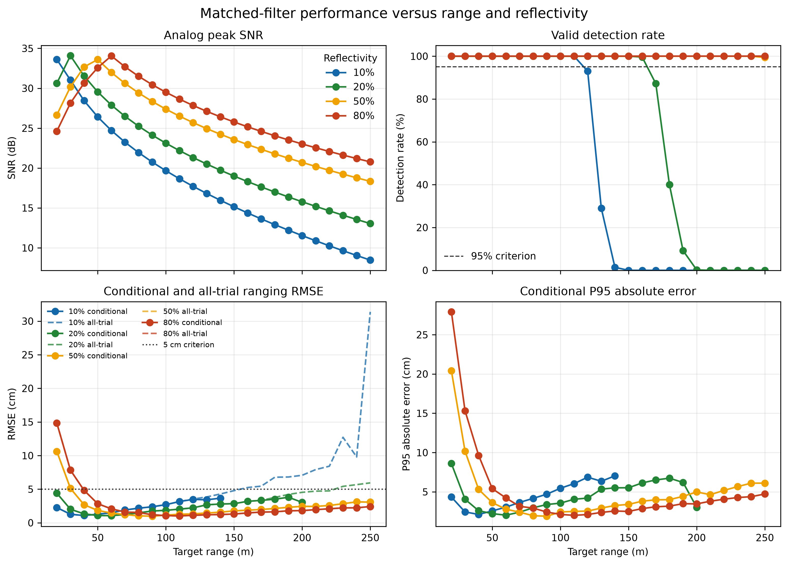

*Figure 5. Detection rate, conditional RMSE, and all-trial RMSE versus range
and target reflectivity. The all-trial metric rises sharply when low-reflectivity
targets exceed the reliable range, even when conditional RMSE remains low.*

## 5 Single-gain dynamic-range analysis

Transimpedance (5, 10, and 20 kΩ) and ADC positive full scale (0.25, 0.5, and 1.0 V) are swept jointly, with Monte Carlo evaluation at each condition.

Table 6. Joint transimpedance and ADC full-scale sweep

| R_f | ADC +FS | 10% reliable range | 80% minimum unsaturated range | 50 m RMSE |
|---:|---:|---:|---:|---:|
| 5 kΩ | 0.25 V | 140 m | 70 m | 1.298 cm |
| 5 kΩ | 1.00 V | 140 m | 40 m | 1.317 cm |
| 10 kΩ | 0.50 V | 150 m | 70 m | 1.249 cm |
| 20 kΩ | 0.50 V | 150 m | 90 m | 1.218 cm |
| 20 kΩ | 1.00 V | 160 m | 70 m | 1.245 cm |

Table 6 is a screening experiment with candidate-dependent ADC ranges and
200 trials per non-baseline condition. Its range endpoints should therefore
not be compared directly with the common-condition, 500-trial architecture
comparison in Table 8. Table 8 is used for the final architecture-level
conclusions.

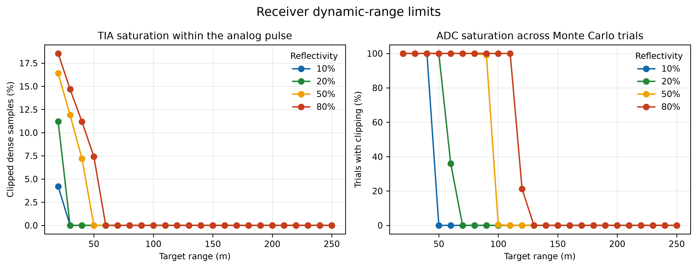

*Figure 6. TIA and ADC saturation boundaries of the single-gain receiver. Left: fraction of TIA-clipped samples versus range. Right: fraction of trials with ADC clipping.*

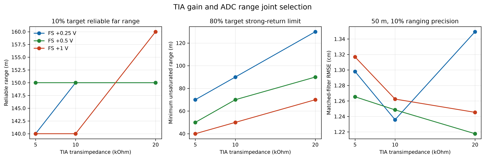

*Figure 7. Joint transimpedance and full-scale selection. Left: reliable range for 10% targets. Center: minimum unsaturated range for 80% targets. Right: ranging RMSE at 50 m.*

At the 50 m weak target all combinations fall between 1.218 cm and 1.317 cm RMSE, a spread of about 8%. The pairing of transimpedance and full scale has little influence on weak-target accuracy, because that accuracy is set by SNR, and SNR is set by the APD and the background.

The principal difference is the minimum unsaturated distance for an 80% target.
The 5 kΩ/0.25 V configuration becomes unsaturated at 70 m, while expanding the
ADC range to 1.0 V reduces this boundary to 40 m. By contrast, the
20 kΩ/0.5 V configuration remains saturated until approximately 90 m.

Reducing transimpedance and increasing ADC full scale improve near-range
headroom, but reduce weak-return voltage and ADC code utilization. No
single-gain configuration simultaneously preserves the long-range sensitivity
of the 20 kΩ path and the near-range headroom of the low-gain path.


Quantization noise is at most 15.8% of the analog noise across all combinations, confirming again that ADC resolution is not the bottleneck.

The conclusion is architectural. One gain must serve two target classes, which is infeasible: the designer can optimize for long range or for short range, but not both.

## 6 Dual-gain receiver design

### 6.1 Architecture selection

Three approaches are commonly used to extend dynamic range:

- **Automatic gain control (AGC).** An AGC receiver must first detect an overload and then change gain. Its response and overload-recovery time depend on the specific circuit. Because a single dToF return lasts only a few nanoseconds, an AGC loop generally cannot complete a closed-loop adjustment within the same return. A dynamic AGC model has not been implemented in this project, so AGC is not included in the quantitative architecture comparison.

- **Logarithmic amplification.** Dynamic range is compressed, but the waveform shape changes and the template required by matched filtering is invalidated.
- **Parallel channels.** Two paths receive and sample simultaneously, and one is selected after the fact. Hardware cost doubles, but there is no switching delay: both paths observe the same return.

This work adopts the parallel architecture. Its cost is a quantifiable increase in hardware; its benefit is the removal of a timing risk intrinsic to the dToF time scale.

### 6.2 Channel parameters and fusion logic

The high-gain channel uses R_f = 20 kΩ and serves weak long-range returns; the low-gain channel uses R_f = 2 kΩ and serves strong short-range returns. Both share one APD current and one sampling phase, and both use an ADC input range of −0.2 V to 1.0 V.

The 2 kΩ value follows from the overload budget. The 20 m, 80% return requires 8.9 V at 20 kΩ and 2.23 V at 5 kΩ, both beyond the 1.0 V full scale; at 2 kΩ the peak is 0.891 V, which fits within the available range. Lower transimpedance would erode weak-signal performance, and higher would fail to cover the nearest, brightest return.

Fusion logic:

The fusion logic uses only observable clipping states and matched-filter
detections. It does not use simulated ground truth.

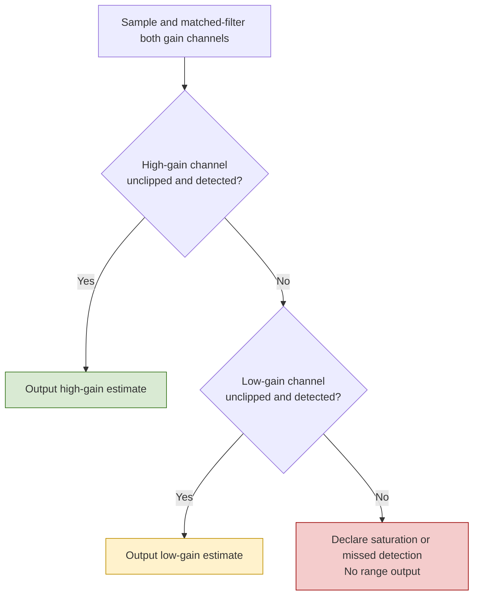

The channel criteria are:

- **Unclipped:** neither the TIA output swing nor the ADC full scale is reached;
- **Detected:** the matched-filter correlation peak exceeds the $`5\sigma`$
  threshold;
- **Priority:** the high-gain channel is preferred to preserve weak-return
  precision; the low-gain channel is selected only when the high-gain path is
  clipped or does not pass detection;
- **Failure handling:** if neither channel is valid, no range is output.

### 6.3 Model corrections

Two settings in the first implementation of the dual-gain study were neither physically consistent nor implementable in hardware. Correcting them changed the results, and the corrections are reported here because they bear directly on the credibility of the numbers.

**6.3.1 Ground-truth leakage.** The first version judged per-channel validity using the simulated true ToF: an estimate counted as valid only if it lay close to ground truth. A receiver cannot do this, and the rule could select a channel in situations where a real receiver would produce no valid output, systematically inflating the apparent benefit of fusion.

In the corrected version, validity depends only on observable quantities: the clipping flags and the correlation-peak threshold. Ground truth is retained for scoring only, to decide whether the channel selection was correct. An estimate deviating from truth by more than 5 ns is counted as a wrong-time selection rather than a successful detection, and is reported separately in the data and figures.

**6.3.2 Noise correlation.** Both channels observe the same APD current, so APD shot noise is a shared source; only the TIA-internal noise is independent. The first version drew independent noise sequences and independent sampling phases for the two paths, which effectively lets the fusion logic retry with independent noise and overstates the benefit of having two channels.

The corrected model:

- draws one sampling phase per trial, shared by both channels;
- draws one standard normal sequence per trial as APD noise, scaled by each channel's transimpedance and shared;
- keeps TIA-internal noise independent between paths;
- sets each channel's detection threshold from its own noise RMS.

The total noise variance is split into an APD term and a TIA term, which are synthesized separately. This remains a white-noise, sample-domain approximation without analog temporal correlation or inter-channel crosstalk, but it gives a more conservative estimate of the dual-gain benefit.

### 6.4 Results

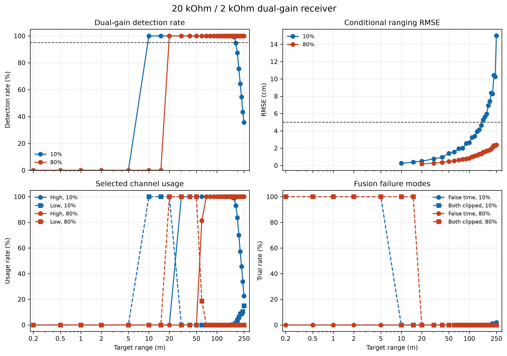

*Figure 8. Detection rate, conditional RMSE, channel usage, and failure modes of the dual-gain receiver.*

Table 7. Near- and far-range behavior of the dual-gain receiver

| Reflectivity | Reliable interval | Low-gain dominant region | Both-channel clipping region |
|---:|---:|---:|---:|
| 10% | 10–150 m | approximately 10–20 m | approximately 0.2–5 m |
| 80% | 20–250 m | approximately 20–50 m | approximately 0.2–15 m |

The near-range extension shows that the 10% target exits simultaneous clipping
between 5 m and 10 m, while the 80% target exits simultaneous clipping between
15 m and 20 m. For the 80% target, the 2 kΩ path dominates from approximately
20 m to 50 m, after which the 20 kΩ path becomes the preferred channel.

At long range, the 10% target remains reliable through 150 m under the common
architecture-comparison conditions. The 80% target remains reliable at the
250 m simulation boundary.

Two distinct failure regions are observed. At very short range, strong returns
clip both channels: approximately 0.2–5 m for the 10% target and 0.2–15 m for
the 80% target on the discrete simulation grid. After the receiver exits this
near-range saturation region, simultaneous clipping is no longer observed.

At the opposite end of the operating range, failures are caused by insufficient
SNR rather than saturation. Wrong-time selections appear only in the weak-return
far-range region and reach a maximum rate of 1.6%.


### 6.5 Near-range saturation and gain handover

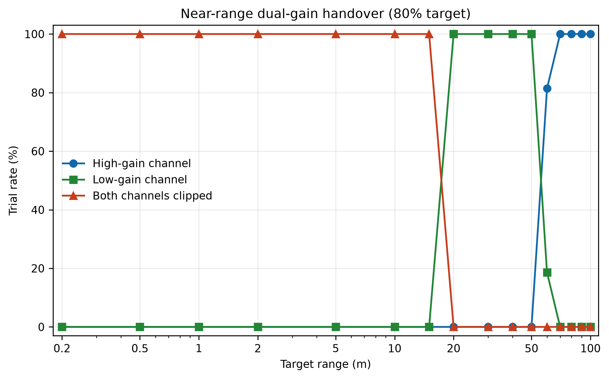

*Figure 8. Near-range saturation and dual-gain handover for an 80% target.
Both channels are clipped from 0.2 m to 15 m on the discrete grid. The 2 kΩ
channel handles returns from approximately 20 m to 50 m, and the 20 kΩ channel
becomes dominant at approximately 60 m.*

### 6.6 Comparison with single-gain receivers

Table 8. Reliable range intervals of the three receiver architectures

| Receiver architecture | 10% target | 20% target | 50% target | 80% target |
|---|---:|---:|---:|---:|
| Single 20 kΩ | 30–150 m | 40–220 m | 50–250 m | 70–250 m |
| Single 2 kΩ | 10–120 m | 10–170 m | 20–250 m | 20–250 m |
| **20/2 kΩ dual gain** | **10–150 m** | **10–220 m** | **20–250 m** | **20–250 m** |

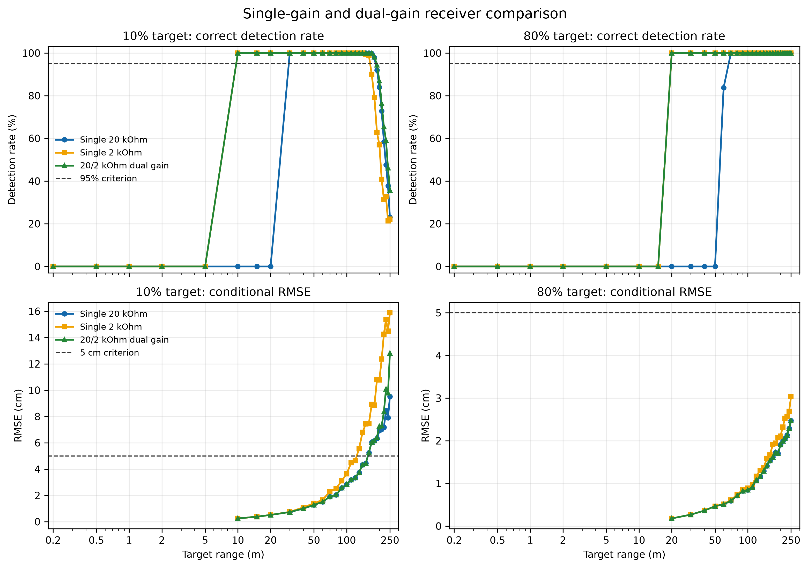

*Figure 10. Correct-detection rate and conditional RMSE of the single 20 kΩ,
single 2 kΩ, and 20/2 kΩ dual-gain receivers.*

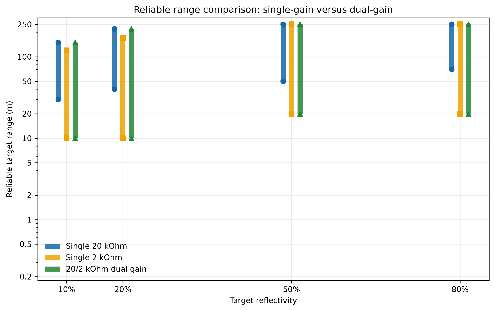

*Figure 11. Reliable range intervals of the three receiver architectures.
The dual-gain design combines the near-range coverage of the low-gain path
with the far-range sensitivity of the high-gain path.*

Compared with the single 20 kΩ receiver, the dual-gain architecture moves the
near reliable boundary of a 10% target from 30 m to 10 m while preserving the
150 m far boundary. For a 20% target, the near boundary moves from 40 m to
10 m while the 220 m far boundary is preserved.

## 7 Conclusions and further work

### 7.1 Observations

(1) In system-level design, effort should follow the dominant error term. Raising the ADC from 8 to 12 bits reduces quantization noise by about 11×, yet ranging accuracy barely moves, because quantization was never dominant. The joint transimpedance and full-scale sweep, by contrast, immediately identifies dynamic range as the actual ceiling.

(2) A local optimum is not a system optimum. 250 MHz is worse than 100 MHz in SNR and worse than 500 MHz in fidelity, but it is the point at which neither loss dominates; 20 kΩ is best at long range and worst at short range, so the answer is not a compromise but two channels.

(3) A model result is meaningful only together with its assumptions. The 1.173 cm RMSE holds for 50 m, 10% reflectivity, 2,000 trials, white noise, and a fixed template. What transfers is the method and its validity envelope, not the number.

(4) The architecture comparison provides the direct baseline for the design decision. The single 20 kΩ path offers the best weak-return sensitivity but
suffers near-range saturation. The single 2 kΩ path improves near-range
headroom but loses far-range performance for low-reflectivity targets. The
dual-gain architecture approximately reproduces the union of the two reliable
regions.

### 7.2 Limitations

**Parameters are not yet bound to parts.** Laser energy, APD responsivity and gain, TIA noise densities, and ADC settings are design baselines rather than values from a named datasheet. Each parameter is tagged by provenance (design, design baseline, literature, simplification) and must be replaced by a datasheet value with a page reference during component selection.

**The physics is simplified.** The target is a Lambertian plane, the receiver is coaxial and far-field, and the return is fully captured; the atmosphere is a uniform extinction medium without rain, fog, or multipath; background light is a parameterized spectral radiance rather than a measured solar spectrum; and noise is white in the sample domain, without 1/f components, temporal correlation, or supply interference.

**The circuit models are first-order.** The TIA is a single-pole low-pass stage without APD junction capacitance, op-amp stability, overload recovery, or printed-circuit-board (PCB) parasitics; the ADC is an ideal quantizer without degradation of the effective number of bits (ENOB), aperture jitter, nonlinearity, or clock phase noise.

**No hardware validation and no eye-safety assessment.** IEC 60825-1 compliance cannot be inferred from pulse energy and must be assessed separately for the actual optical path and repetition rate.

### 7.3 Next steps

1. **Bind parameters to real parts.** Select specific laser, APD/TIA, and ADC devices, and record typical and guaranteed values together with part number, revision, and page.
2. **Add the missing non-idealities.** Overload recovery (which decides whether AGC-type approaches are viable), APD junction capacitance and its effect on bandwidth, ADC ENOB and jitter, and temperature drift.
3. **Calibrate against measurement.** Capture return waveforms over range, reflectivity, and ambient light with a pulsed laser, a target board, and an oscilloscope, then run a residual analysis to test the assumptions.

## Appendix A — Baseline parameters

The "Source" column records the current confidence level of each value. *Design* marks a system parameter that is free to optimize; *design baseline* marks an operating point chosen at typical device level and still to be replaced; *literature* marks a value taken from a published model; *simplification* marks a modeling assumption that carries no device guarantee.

| Category | Parameter | Value | Source |
|---|---|---:|---|
| Laser | Wavelength | 905 nm | Design |
| | Pulse energy / FWHM | 500 nJ / 5 ns | Design |
| | Initial beam diameter / divergence | 3 mm / 1 mrad (full angle) | Design |
| | Transmit efficiency | 0.85 | Simplification |
| Target | Projected area / incidence angle | 10 m² / 0° | Simplification |
| Atmosphere | Extinction coefficient | 1×10⁻⁴ m⁻¹ | Simplification |
| Receiver | Aperture / optical efficiency | 25 mm / 0.75 | Design / simplification |
| Background | Spectral radiance | 0.30 W m⁻² sr⁻¹ nm⁻¹ | Simplification |
| | Field of view / filter bandwidth | 2 mrad / 10 nm | Design |
| APD | Responsivity / gain | 0.50 A/W / 50 | Design baseline |
| | Ionization ratio / dark current | 0.02 / 5 nA | Literature / design baseline |
| TIA | Transimpedance / bandwidth | 20 kΩ / 250 MHz | Design |
| | Input current noise / output noise | 3 pA/√Hz / 5 nV/√Hz | Design baseline |
| | Output swing | ±1.0 V | Design |
| ADC | Sample rate / resolution | 1 GHz / 10 bit | Design |
| | Input range (single-gain / dual-gain) | −0.05–0.25 V / −0.2–1.0 V | Design |
| Dual gain | High / low transimpedance | 20 kΩ / 2 kΩ | Design |

## Appendix B — Reproducing the results

```bash
python3.12 -m venv .venv
source .venv/bin/activate
python -m pip install -e '.[dev]'
python -m pytest -v

python scripts/run_baseline.py                 # optical-link baseline
python scripts/run_optical_validation.py       # inverse-square validation, energy sweep
python scripts/run_detector_baseline.py        # APD baseline
python scripts/run_tia_bandwidth_study.py      # bandwidth selection
python scripts/run_adc_study.py                # sample rate and resolution
python scripts/run_ranging_study.py            # four ranging estimators
python scripts/run_range_performance_sweep.py  # range and reflectivity sweep
python scripts/run_frontend_selection.py       # transimpedance and full-scale sweep
python scripts/run_dual_gain_study.py          # dual-gain validation
python scripts/run_architecture_comparison.py  # single- versus dual-gain comparison
```

All Monte Carlo scripts use fixed random seeds. CSV output is written to `results/data/` and PNG/PDF figures to `results/figures/`. The test suite covers pulse energy integration, ToF mapping, the inverse-square law, quantum efficiency, noise bandwidth, TIA DC gain and clipping, ADC sampling and the quantization bound, threshold and sub-sample peak location, matched filtering, reliable-range classification, and fusion logic; approximately 30 tests currently pass.

## Appendix C — Repository layout

```text
configs/            System design parameters (YAML)
src/lidar_sim/      Optical, detector, TIA, ADC, and ranging models
scripts/            Reproducible experiment scripts
results/data/       Numerical output (CSV)
results/figures/    Figures (PNG/PDF)
tests/              Physical and numerical consistency tests
docs/               Model derivations and parameter provenance
```

---

*All results in this report are model predictions. When quoting a number, quote the model boundaries in Section 7.2 with it.*
